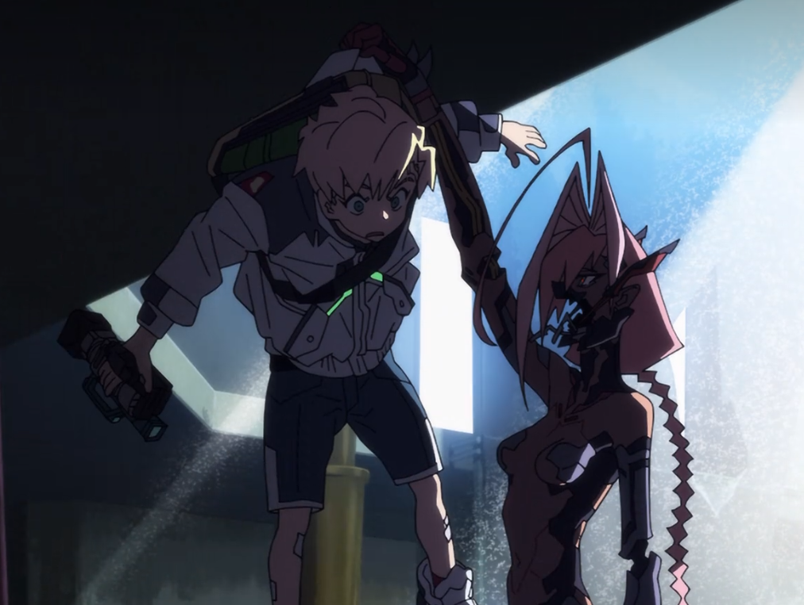
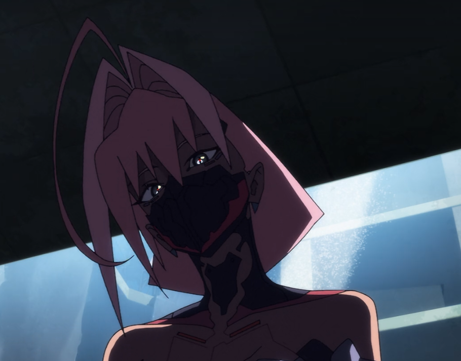
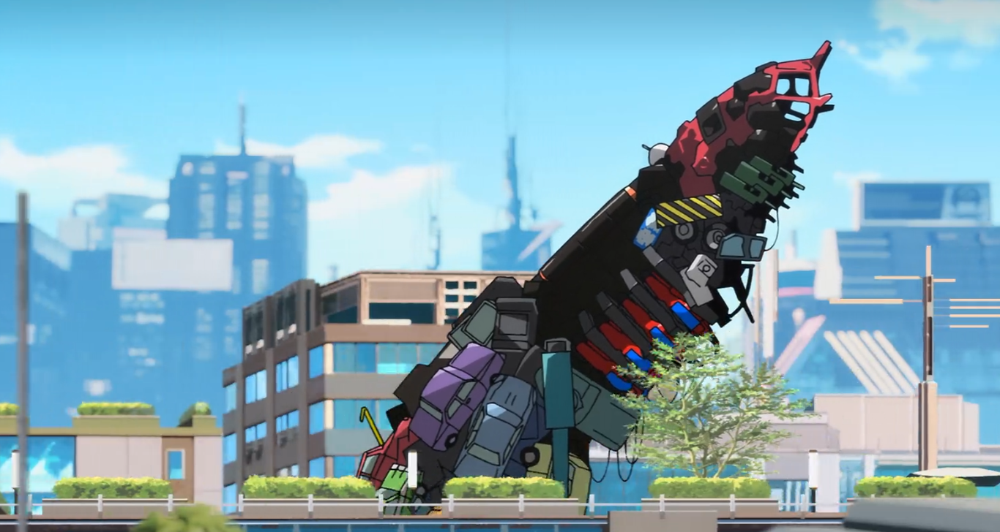
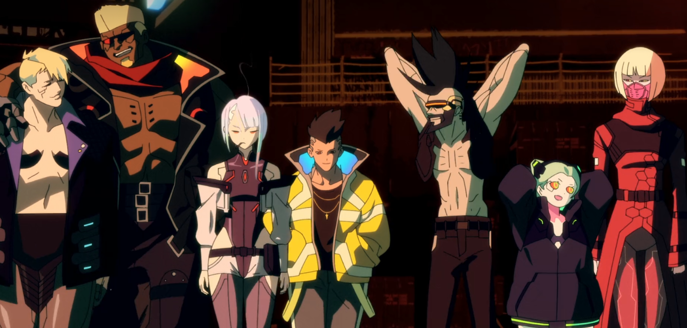
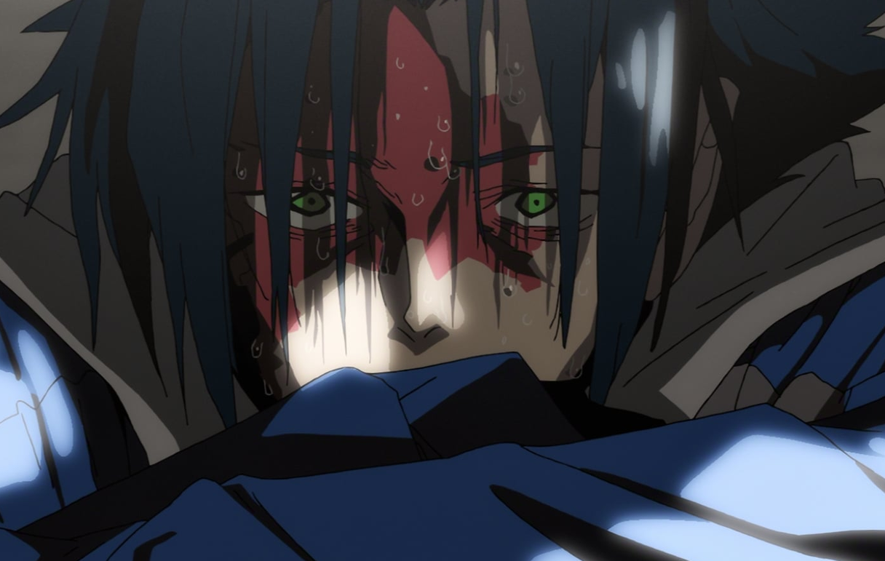

---
# Tradução automática de index.mdx (pt -> en).
# Editou à mão? Mude "revisado" para true e o script nunca mais sobrescreve.
titulo: "Cyberpunk: Edgerunners 2"
tipo: anime
plataforma: Netflix
duracao: "10 episodes: 4 hours and 35 minutes."
capa: ../cyberpunk-edgerunners-2/capa.png
nota: 6.9
roll: greed
motivoRoll: Good for a distraction and for fans of Cyberpunk 2077, but far from a must-play.
frase: Good while it lasts, just not exactly memorable.
atributos:
  - nome: Cyberpunk
    valor: "+10"
  - nome: Soundtrack
    valor: "-21"
tags:
  - cyberpunk
  - edgerunners
  - studio-trigger
  - anime
data: 2026-10-25
idioma: en
rascunho: false
origemHash: 6ef112ca293001fa7d63c7717965e9795b5bf1be963c76062b2abba458f83aa7
revisado: false
modelo: "@cf/google/gemma-4-26b-a4b-it"
---
# A good season, but falls short of the first

I just finished the second season of *Cyberpunk: Edgerunners* and I was left with a feeling of: "Okay, that was it...". I don't think it's a bad season, but I feel it fell considerably below the first, both in terms of writing and animation. And, thinking about it... even the soundtrack.

The first season managed to build a very striking identity, combining dynamic animation, an aesthetic faithful to the *Cyberpunk 2077* universe, engaging characters, a good script, and a memorable soundtrack. The second tried to follow a different path, but I get the impression that some of the creative decisions ended up hurting the very elements that made the original so special.

## The change in art direction and its possible impacts on animation

Starting with the animation, I believe the decision to radically change the art direction was one of the main problems with the production.

From what I researched, Bartosz Sztybor, a showrunner and producer linked to CD Projekt RED, established that the second season should have a different identity from the first. His initial proposal was to pay homage to 90s cinema, citing films like *Pulp Fiction* and *Léon: The Professional*. Riding this wave, the new director, Kai Ikarashi, decided to expand this inspiration, also incorporating the aesthetic of 80s and 90s anime.

This information made me particularly curious about the creative process. Did Sztybor intend to mainly adopt a narrative language inspired by the cinema of that era, while Ikarashi decided to take the proposal into the visual style as well? Interviews indicate there was an intention to visually differentiate the seasons, but they don't make it completely clear how far the initial proposal went and which decisions arose later.

In any case, I don't consider the drawings bad. The art is very well done, and I recognize the talent involved in building that aesthetic. However, the line art inspired by old anime simply isn't my personal taste.

Since aesthetics are, for the most part, a matter of taste, my most serious criticism lies in the animation itself. The second season presents many characteristics of limited animation:

* More static frames.
* Many shots that deliberately hide the characters' mouths during dialogue, bypassing the need to animate lip movements.
* Combat sequences that convey a sense of fluidity inferior to the first season.

At several moments, I had the feeling of watching a succession of elaborate illustrations with little movement between them, something I saw quite a bit in the TV version of *JJK2*. This particularly bothered me in the action scenes, which was exactly one of the aspects where Studio Trigger had stood out so much in the first season.

With all these pieces, I have my theory about what might have happened behind the scenes. Nothing confirmed, just my own headcanon.

A significant change in art direction requires adaptations in practically every stage of production, since new standards for drawing, composition, lighting, and visual effects can demand adjustments in workflows, revisions, and even rework. Depending on the available schedule, this can reduce the time allocated to animating certain sequences.

I wonder if this change ended up compromising the production planning, forcing the team to resort to animation saving resources to manage to deliver the episodes.

It is also possible that part of these techniques was used deliberately as a stylistic resource, especially since they are also present in the first season, but they seem to have been better incorporated.

Personally, in the case of the second season, I doubt they were all purely artistic choices. In the end, the main issue is the result: regardless of the intention, I consider that the animation lost fluidity, dynamism, and impact compared to the first season.

Personally, I would have preferred they kept the original art style and concentrated their efforts on ensuring animation as fluid and well executed as the first season.

## The soundtrack: one of the most forgettable elements of the season

Another aspect that disappointed me was the soundtrack.

The music was one of the most striking elements of the first season of *Edgerunners*. It didn't just serve as background for the scenes, it helped build the atmosphere, the identity, and, most importantly, the emotional impact of the story.

Some songs became so associated with certain events that hearing them again is enough to bring back the emotions of those scenes. It is no coincidence that several of them ended up being used in internet memes.

*I Really Want to Stay at Your House* is probably the most evident example of this. Its association with David and Lucy turned the song into something practically inseparable from the story.

<YouTube id="KvMY1uzSC1E" titulo="Cyberpunk: Edgerunners | “I Really Want to Stay At Your House” by Rosa Walton | Music Video" />

In the second season, I felt absolutely nothing like that. The soundtrack seemed so insignificant to me that, when I finished the ten episodes, I realized I couldn't remember a single song.

No composition particularly caught my attention, none became associated with an important moment, and none sparked that urge to look it up to listen to it again.

This is especially disappointing in a work set in the *Cyberpunk 2077* universe, where music plays such an important role in building the atmosphere and cultural identity.

The first season managed to transform certain songs into part of the viewer's emotional experience. The second just passed through me without leaving any relevant musical memory.

## The inconsistency of powers and the exaggerated spectacle

Another issue lies in how the second season represents the powers and technological modifications of its characters. At certain points, the series seems to abandon the technological logic of its own universe in favor of an increasingly exaggerated visual spectacle.

*Cyberpunk 2077* presents extremely advanced technologies, radical body mods, and individuals capable of performing superhuman feats. However, there is a technological logic behind these abilities, even when it is pushed to the limit for the sake of action.

In the second season, some manifestations of power seem to bypass these limits without the script offering a convincing foundation for this power creep.

And this becomes particularly evident in Talia's transformations. Her capabilities take on increasingly absurd proportions, with metal components floating around her, apparently attracted by some kind of magnetism, until she reaches that gigantic mechanical creature, which looks more like a battle anime monster to me than something belonging to the *Cyberpunk 2077* universe.

It is not that the series fails to offer any technological explanation for these abilities, but it feels insufficient compared to what is happening on screen. The impression is that the powers keep scaling up simply because the story needs a bigger spectacle.

And it is not as if the first season avoided exaggerations. David himself uses an absurdly powerful cyber-skeleton in season 1. The difference is that the technology had a more convincing foundation within the narrative, with clearly established limitations and physical consequences. Even facing something so extreme, I could still recognize a logic compatible with that universe.

In the second, the escalation feels increasingly fantasy-based. Talia practically transforms into a giant metal monster, D also ends up resorting to an extraordinary suit of armor, and everything takes on proportions that, to me, feel closer to a superpower anime than to the sci-fi of *Cyberpunk*.

To make matters worse, even the visual execution failed to convince me.

Aside from not particularly liking the design of Talia's final transformation, I think the sequence itself was poorly animated. The creature's movements did not convey the weight, fluidity, or grandeur I expected from a confrontation of that scale. At some points, it looked almost like a static image with a moving background.

Instead of being impressed by the transformation, I ended up paying more attention to the visual limitations of the scene.

The result is that a sequence apparently designed to be one of the season's big spectacles ended up becoming, in my eyes, one of the clearest examples of its art direction and animation problems.

In the end, it does not bother me that *Cyberpunk* presents absurd technologies or extremely powerful characters. What bothers me is when the exaggeration seems to exist for its own sake, without a build capable of making that spectacle convincing.

## The script and the difficulty of creating emotional connections

Perhaps my biggest problem with the second season lies in the script, especially the difficulty I had in creating emotional connections with its characters.

In the first season, David, Lucy, Maine, Rebecca, and the others formed a group whose relationships were built through living together, conflicts, and shared experiences. It was not necessary to deeply develop every character for us to care about them. We followed David's journey and, through it, ended up getting invested in the people around him.

In the second, I missed that connection. The friendship between D and Roman, for example, never felt strong enough to justify so much loyalty. In several situations, I wondered why Roman did not simply abandon him. Perhaps the fascination with the story he was recording was part of the answer, but I did not always feel that the script sufficiently explored his motivations.

That was when I started questioning my own critique: **should these characters even be forming a team?**

Thinking better of it, maybe I was expecting something from the second season that it never intended to offer. Unlike the first, here we follow individuals with their own stories whose paths happen to cross.

The problem, therefore, might not have been the absence of a team, but the way these stories were developed and connected.

Curiously, some relationships worked very well for me. I really liked the youthful romantic tension between Talia and Roman, but mainly her conflicts with her mother. There was a very strong emotional weight in watching Avida trying to save her daughter at any cost, while suffering as she realized that, with every new modification, that girl who once held her finger so tightly seemed to lose herself a little more. It was the conflict of a mother who wanted to see her daughter cured, but feared that, in the process, she would cease to be who she was.

In fact, I was often more interested in following Talia, her relationship with Roman, and the mysteries of her past than discovering what would happen to the other protagonists.

And it was while writing this review that I noticed something curious: **Talia was the common thread in almost everything that actually engaged me this season.**

Her family conflicts, her rebellion, her insecurities, and the consequences of her body mods gave her relationships a human dimension that I felt was missing in the other stories.

D's revenge arc, basically a budget Sasuke from the future, never managed to win me over. There was mystery, violence, and action sequences, but his story felt distant to me, plus a bit cliché. Weak also presented an interesting premise: an old edgerunner forced to live with his own decay. However, I wish this conflict had received more attention, because I frequently felt like his participation boiled down to just protecting Talia.

Roman, on the other hand, provoked a different kind of annoyance.

His premise was one of the most interesting: a boy passionate about movies, who rejected braindances and wanted to record real stories. However, as the season progressed, I got the impression that his own journey was losing importance. He followed D, recorded the events, and reacted to what was happening around him, but he rarely seemed to determine the direction of the story.

And I am not talking about a lack of evolution here, but a **lack of agency**.

Roman didn't need to abandon his ideals or go through a massive transformation. A character can remain faithful to their own convictions and, still, make decisions that significantly influence events.

His filming has consequences in the narrative, true, but that is exactly where another problem arises: these consequences don't always seem to arise naturally from his choices. Frequently, I get the feeling that the script needs to assign importance to what Roman records just to justify his presence in the story, instead of building that importance in a convincing way.

Researching Roman, I discovered that, according to Bartosz Sztybor, the character emerged during the story's development as a representation of the creators' own love for cinema.

This made me wonder if this artistic intention ended up overriding the needs of the narrative.

It doesn't bother me that Roman represents a personal passion of the authors. The problem is that, in my view, this idea wasn't integrated organically enough into the story. Even when his filming produces important events, I frequently feel they gain relevance because the script needs them to, not because that importance was built throughout his journey.

It is as if the creators knew exactly what they wanted Roman to represent, but failed to transform that representation into a character as dramatically interesting as his premise promised.

And maybe that is exactly why his symbolic function seems more evident to me than his relevance within the story itself.

Thinking about this, another question occurred to me: **was the problem the absence of a clearly established protagonist?**

In the first season, David functioned as the narrative and emotional center. His decisions drove the story, and his relationships gave meaning to the events. Even when we disagreed with his choices, we understood his motivations and felt the weight of the consequences.

In the second, these functions seem distributed among different characters. D moves a good part of the plot, Weak has his own conflicts, and Talia concentrates most of the emotional involvement. Roman... "I'm just happy to be here."

What bothered me was that these trajectories, individually and when they met, could not always spark the interest their premises promised. While D led the events, it was Talia who made me actually care about the characters' fates.

And I think I can finally identify what I felt was missing from the script.

The first season managed to make me care about David's story and, consequently, about the people who were part of it. The second presented me with several stories, but few managed to engage me in the same way.

In the end, it didn't need another David, nor another mercenary crew. It just needed those trajectories, no matter how different they were, to be able to turn their encounters, conflicts, and choices into something that actually made me care about what would happen next.

## A season that tried to do too much at once

Looking at the work as a whole, I get the impression that *Edgerunners 2* tried to achieve too many ambitions simultaneously.

The production sought to establish a new artistic identity, pay homage to different cinematic traditions, work with multiple protagonists, develop parallel stories, and deliver increasingly grand confrontations. All this in just ten episodes.

The result was a season with good ideas, but with irregular execution. The art direction changed radically and the animation lost some of the fluidity and impact of the first season. The narrative adopted a more fragmented structure, but did not always manage to develop its stories and characters convincingly. The confrontations grew to larger proportions, sometimes straying from the technological logic of *Cyberpunk 2077*, while the soundtrack lost much of the emotional presence that had marked the series.

Individually, these choices would already be debatable. Together, they left me with the feeling that the production was so worried about building something different that it ended up compromising part of what made *Edgerunners* special.

And maybe that is my biggest frustration with the second season.

The first season had found a very successful balance between visual identity, dynamic animation, captivating characters, emotionally engaging narrative, and a memorable soundtrack. The second decided to reformulate much of that identity, and I continue to question the need for so many changes.

Would they have had this concern about doing something different stemming from a genuine artistic need or, at least in part, from a certain intellectual vanity of the creators, who were more interested in expressing their own ambitions than in evaluating if they would actually work within the piece?

Perhaps the most evident example of this doubt is Roman. The idea of paying homage to cinema through a character is interesting, but if this homage fails to integrate naturally into the narrative, to what extent is it serving the story, and not just the ego of the writer?

Of course, I have no way of knowing what the creators' personal motivations were, but the impression left is that some decisions received more attention for what they intended to represent than for how they actually functioned on screen.

After all, innovating doesn't necessarily require abandoning what already works. A new story, with different characters and its own approach, could have expanded the *Edgerunners* universe without giving up so many of the elements that made the first season such a striking experience.

**In the end, the second season didn't need to repeat the first. But it also didn't need to abandon so many of the elements that made it a success.**

## **Conclusion:**

*Cyberpunk: Edgerunners 2* is a good season. It remains a fun experience, set in a fascinating universe, and has its moments of action and emotion. However, due to the issues I discussed throughout this review, I consider it to be considerably below the first one.

It is an anime that entertains, but it is unlikely to leave such a lasting impression. It lacked that level of engagement that makes you care deeply about the characters, makes you anxious for the next episode, and keeps you thinking about the story long after you've finished it.

I don't consider it a bad season, much less a waste of time. It is a perfectly valid option for those who like *Cyberpunk* and are looking for something to watch and unwind. **But it is far from a must-watch experience. It's good while it lasts, it's just not particularly memorable.**
