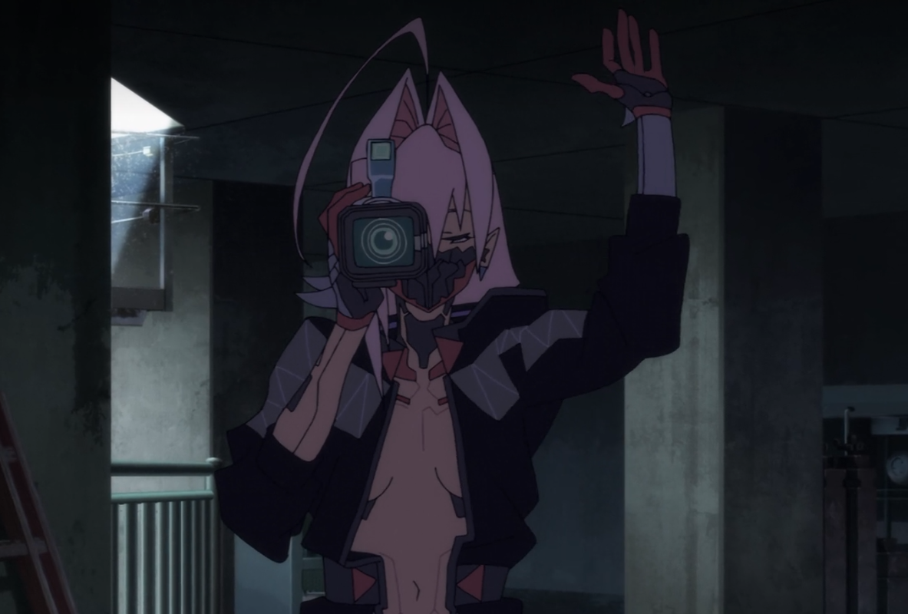

# Uma boa temporada, mas aquém da primeira

Acabei de terminar a segunda temporada de *Cyberpunk: Edgerunners* e fiquei com uma sensação de: "Ok, foi isso...". Não acho que seja uma temporada ruim, mas considero que ela ficou consideravelmente abaixo da primeira, tanto em termos de roteiro quanto de animação. E, pensando melhor... até mesmo na trilha sonora.

A primeira temporada conseguiu construir uma identidade muito marcante, combinando uma animação dinâmica, uma estética fiel ao universo de *Cyberpunk 2077*, personagens envolventes, um bom roteiro e uma trilha sonora memorável. A segunda tentou seguir um caminho diferente, mas tenho a impressão de que algumas das decisões criativas acabaram prejudicando justamente os elementos que tornaram a original tão especial.

## A mudança de direção artística e seus possíveis impactos na animação

Começando pela animação, acredito que a decisão de mudar radicalmente a direção artística tenha sido um dos principais problemas da produção.

Pelo que pesquisei, Bartosz Sztybor, showrunner e produtor ligado à CD Projekt RED, estabeleceu que a segunda temporada deveria ter uma identidade diferente da primeira. Sua proposta inicial era homenagear o cinema dos anos 90, citando filmes como *Pulp Fiction* e *Léon: The Professional*. Embarcando nessa onda, o novo diretor, Kai Ikarashi, decidiu expandir essa inspiração, incorporando também a estética dos animes dos anos 80 e 90.

Essa informação me deixou particularmente curioso sobre o processo criativo. Será que Sztybor pretendia principalmente adotar uma linguagem narrativa inspirada no cinema daquela época, enquanto Ikarashi resolveu levar a proposta também para o estilo visual? As entrevistas indicam que havia uma intenção de diferenciar visualmente as temporadas, mas não deixam completamente claro até onde ia a proposta inicial e quais decisões surgiram posteriormente.

De qualquer forma, não considero os desenhos ruins. As artes são muito bem feitas, e reconheço o talento envolvido na construção daquela estética. Porém, o traço inspirado nos animes antigos simplesmente não é do meu gosto pessoal.

Como a estética é, em grande parte, uma questão de gosto, minha crítica mais séria está na animação propriamente dita. A segunda temporada apresenta muitos recursos característicos de animação limitada:

* Mais quadros estáticos.
* Muitos enquadramentos que deliberadamente ocultam a boca dos personagens durante os diálogos, dispensando a necessidade de animar os movimentos labiais.
* Sequências de combate que transmitem uma sensação de fluidez inferior à da primeira temporada.

Em vários momentos, tive a sensação de estar assistindo a uma sucessão de ilustrações elaboradas, mas com pouco movimento entre elas, algo que vi bastante na versão de *JJK2* para TV. Isso me incomodou particularmente nas cenas de ação, justamente um dos aspectos em que o Studio Trigger havia se destacado tanto na primeira temporada.

Com todas essas peças, tenho minha teoria sobre o que pode ter acontecido nos bastidores. Nada confirmado, só achismos da minha mente.

Uma mudança significativa de direção artística exige adaptações em praticamente todas as etapas da produção, uma vez que novos padrões de desenho, composição, iluminação e efeitos visuais podem demandar ajustes nos processos de trabalho, revisões e até retrabalho. Dependendo do cronograma disponível, isso pode reduzir o tempo destinado à animação de determinadas sequências.

Fico me perguntando se essa mudança não acabou comprometendo o planejamento da produção, obrigando a equipe a recorrer a recursos de economia de animação para conseguir entregar os episódios.

Também é possível que parte dessas técnicas tenha sido utilizada deliberadamente como recurso estilístico, até porque elas também estão presentes na primeira temporada, mas parecem ter sido melhor incorporadas.

Particularmente, no caso da segunda temporada, duvido que todas tenham sido escolhas puramente artísticas. No fim, a questão principal é o resultado: independentemente da intenção, considero que a animação perdeu fluidez, dinamismo e impacto em comparação com a primeira temporada.

Pessoalmente, teria preferido que mantivessem o estilo artístico original e concentrassem os esforços em garantir uma animação tão fluida e bem executada quanto a da primeira temporada.

## A trilha sonora: um dos elementos mais esquecíveis da temporada

Outro aspecto que me decepcionou foi a trilha sonora.

A música foi um dos elementos mais marcantes da primeira temporada de *Edgerunners*. Não servia apenas como acompanhamento das cenas, mas ajudava a construir a atmosfera, a identidade e, principalmente, o impacto emocional da história.

Algumas músicas ficaram tão associadas a determinados acontecimentos que ouvi-las novamente é suficiente para trazer de volta as emoções daquelas cenas. Não por acaso, várias delas acabaram sendo utilizadas em memes pela internet.

*I Really Want to Stay at Your House* é provavelmente o exemplo mais evidente disso. Sua associação com David e Lucy transformou a música em algo praticamente inseparável da história.

<YouTube id="KvMY1uzSC1E" titulo="Cyberpunk: Edgerunners | “I Really Want to Stay At Your House” by Rosa Walton | Music Video" />

Na segunda temporada, não senti absolutamente nada parecido. A trilha sonora me pareceu tão insignificante que, quando terminei os dez episódios, percebi que não conseguia me lembrar de uma única música.

Nenhuma composição chamou particularmente minha atenção, nenhuma ficou associada a um momento importante e nenhuma despertou aquela vontade de procurá-la para ouvir novamente.

Isso é especialmente decepcionante em uma obra ambientada no universo de *Cyberpunk 2077*, no qual a música desempenha um papel tão importante na construção da atmosfera e da identidade cultural.

A primeira temporada conseguiu transformar determinadas músicas em parte da experiência emocional do espectador. Já a segunda passou por mim sem deixar nenhuma lembrança musical relevante.

## A inconsistência dos poderes e o espetáculo exagerado

Outro problema está na maneira como a segunda temporada representa os poderes e as modificações tecnológicas de seus personagens. Em determinados momentos, a série parece abandonar a lógica tecnológica do próprio universo em favor de um espetáculo visual cada vez mais exagerado.

*Cyberpunk 2077* apresenta tecnologias extremamente avançadas, modificações corporais radicais e indivíduos capazes de realizar feitos sobre-humanos. Entretanto, existe uma lógica tecnológica por trás dessas capacidades, mesmo quando ela é extrapolada em nome da ação.

Na segunda temporada, algumas manifestações de poder parecem ultrapassar esses limites sem que o roteiro ofereça uma fundamentação convincente para essa escalada.

E isso fica particularmente evidente nas transformações de Talia. Suas capacidades vão assumindo proporções cada vez mais absurdas, com componentes metálicos flutuando ao seu redor, aparentemente atraídos por alguma espécie de magnetismo, até chegar àquela criatura mecânica gigantesca, que mais me parece um monstro de anime de batalha do que algo pertencente ao universo de *Cyberpunk 2077*.

Não é que a série não ofereça qualquer explicação tecnológica para essas capacidades, mas ela me parece insuficiente diante do que acontece na tela. A impressão é de que os poderes vão aumentando simplesmente porque a história precisa de um espetáculo cada vez maior.

E não é como se a primeira temporada evitasse exageros. O próprio David chega a utilizar um ciberesqueleto absurdamente poderoso na season 1. A diferença é que aquela tecnologia possuía uma fundamentação mais convincente dentro da narrativa, com limitações e consequências físicas claramente estabelecidas. Mesmo diante de algo tão extremo, ainda conseguia reconhecer uma lógica compatível com aquele universo.

Na segunda, a escalada me parece cada vez mais fantasiosa. Talia se transforma praticamente em um monstro gigante de metal, D também acaba recorrendo a uma armadura extraordinária, e tudo vai adquirindo proporções que, para mim, se aproximam mais de um anime de superpoderes do que da ficção científica de *Cyberpunk*.

E, para piorar, nem a execução visual conseguiu me convencer.

Além de não gostar particularmente do design da transformação final de Talia, considero que a própria sequência foi mal animada. Os movimentos da criatura não transmitiram o peso, a fluidez ou a grandiosidade que eu esperava de um confronto daquela escala. Em alguns momentos, parecia uma imagem quase estática, com o fundo se movendo.

Em vez de ficar impressionado com a transformação, acabei prestando mais atenção nas limitações visuais da cena.

O resultado é que uma sequência aparentemente concebida para ser um dos grandes espetáculos da temporada acabou se tornando, aos meus olhos, um dos exemplos mais evidentes de seus problemas de direção artística e animação.

No fim, não me incomoda que *Cyberpunk* apresente tecnologias absurdas ou personagens extremamente poderosos. O que me incomoda é quando o exagero parece existir por si só, sem uma construção capaz de tornar aquele espetáculo convincente.

## O roteiro e a dificuldade de criar conexões emocionais

Talvez meu maior problema com a segunda temporada esteja no roteiro, especialmente na dificuldade que tive para criar conexões emocionais com seus personagens.

Na primeira temporada, David, Lucy, Maine, Rebecca e os demais formavam um grupo cujas relações eram construídas a partir da convivência, dos conflitos e das experiências compartilhadas. Não era necessário desenvolver profundamente cada personagem para que nos importássemos com eles. Acompanhávamos a trajetória de David e, através dela, acabávamos nos envolvendo com as pessoas ao seu redor.

Na segunda, senti falta dessa conexão. A amizade entre D e Roman, por exemplo, nunca me pareceu forte o suficiente para justificar tanta lealdade. Em diversas situações, me perguntava por que Roman simplesmente não o abandonava. Talvez o fascínio pela história que estava registrando fosse parte da resposta, mas nem sempre senti que o roteiro explorava suficientemente suas motivações.

Foi então que comecei a questionar minha própria crítica: **será que esses personagens deveriam mesmo formar uma equipe?**

Pensando melhor, talvez eu estivesse esperando da segunda temporada algo que ela nunca pretendeu oferecer. Diferentemente da primeira, aqui acompanhamos indivíduos com histórias próprias, cujos caminhos acabam se cruzando.

O problema, portanto, talvez não estivesse na ausência de uma equipe, mas na maneira como essas histórias eram desenvolvidas e se conectavam.

Curiosamente, algumas relações funcionaram muito bem para mim. Gostei bastante da tensão romântica juvenil entre Talia e Roman, mas principalmente dos conflitos dela com a mãe. Havia uma carga emocional muito forte em acompanhar Avida tentando salvar a filha a qualquer custo, enquanto sofria ao perceber que, a cada nova modificação, aquela menina que um dia segurava seu dedo com tanta força parecia se perder um pouco mais. Era o conflito de uma mãe que queria ver a filha curada, mas temia que, no processo, ela deixasse de ser quem era.

Na verdade, frequentemente me interessava mais acompanhar Talia, sua relação com Roman e os mistérios do seu passado do que descobrir o que aconteceria com os demais protagonistas.

E foi escrevendo esta crítica que percebi algo curioso: **Talia era o ponto em comum de praticamente tudo aquilo que realmente me envolveu na temporada.**

Seus conflitos familiares, sua rebeldia, suas inseguranças e as consequências das modificações corporais davam às suas relações uma dimensão humana que senti faltar nas outras histórias.

O arco de vingança de D, o Sasuke da Shopee do futuro, por exemplo, nunca conseguiu me conquistar. Havia mistério, violência e sequências de ação, mas sua história me parecia distante, além de um tanto clichê. Weak também apresentava uma premissa interessante: um antigo edgerunner obrigado a conviver com a própria decadência. Entretanto, gostaria que esse conflito tivesse recebido mais atenção, pois frequentemente sentia que sua participação se resumia a proteger Talia.

Já Roman me provocou um incômodo diferente.

Sua premissa era uma das mais interessantes: um garoto apaixonado por filmes, que rejeitava os braindances e queria registrar histórias reais. Entretanto, conforme a temporada avançava, tive a impressão de que sua própria trajetória perdia importância. Ele acompanhava D, registrava os acontecimentos e reagia ao que acontecia ao seu redor, mas raramente parecia determinar o rumo da história.

E aqui não estou falando de falta de evolução, mas de **falta de agência**.

Roman não precisava abandonar seus ideais nem passar por uma grande transformação. Um personagem pode permanecer fiel às próprias convicções e, ainda assim, tomar decisões que influenciem significativamente os acontecimentos.

Suas filmagens têm consequências na narrativa, é verdade, mas é justamente aí que surge outro problema: essas consequências nem sempre me parecem surgir naturalmente de suas escolhas. Frequentemente, tenho a sensação de que o roteiro precisa atribuir importância ao que Roman registra para justificar sua presença na história, em vez de construir essa importância de maneira convincente.

Pesquisando sobre Roman, descobri que, segundo Bartosz Sztybor, o personagem surgiu durante o desenvolvimento da história como uma representação do amor dos próprios criadores pelo cinema.

Isso me fez questionar se essa intenção artística não acabou se sobrepondo às necessidades da narrativa.

Não me incomoda que Roman represente uma paixão pessoal dos autores. O problema é que, na minha percepção, essa ideia não foi integrada de maneira suficientemente orgânica à história. Mesmo quando suas filmagens produzem acontecimentos importantes, frequentemente sinto que elas ganham relevância porque o roteiro precisa que isso aconteça, e não porque aquela importância foi construída ao longo de sua trajetória.

É como se os criadores soubessem exatamente o que queriam que Roman representasse, mas não tivessem conseguido transformar essa representação em um personagem dramaticamente tão interessante quanto sua premissa prometia.

E talvez seja justamente por isso que sua função simbólica me pareça mais evidente do que sua relevância dentro da própria história.

Foi pensando nisso que outra questão me ocorreu: **será que o problema era a ausência de um protagonista claramente estabelecido?**

Na primeira temporada, David funcionava como o centro narrativo e emocional. Suas decisões impulsionavam a história, e suas relações davam significado aos acontecimentos. Mesmo quando discordávamos de suas escolhas, compreendíamos suas motivações e sentíamos o peso das consequências.

Na segunda, essas funções parecem distribuídas entre diferentes personagens. D movimenta boa parte da trama, Weak possui seus próprios conflitos e Talia concentra boa parte do envolvimento emocional. Roman… "Estou apenas feliz por estar aqui".

O que me incomodou foi que essas trajetórias, individualmente e quando se encontravam, nem sempre conseguiam despertar o interesse que suas premissas prometiam. Enquanto D conduzia os acontecimentos, era Talia quem me fazia realmente importar com o destino dos personagens.

E acho que finalmente consigo identificar o que senti faltar no roteiro.

A primeira temporada conseguia fazer com que eu me importasse com a história de David e, por consequência, com as pessoas que faziam parte dela. A segunda me apresentou várias histórias, mas poucas conseguiram me envolver da mesma maneira.

No fim, não precisava de outro David, nem de outra equipe de mercenários. Precisava apenas que aquelas trajetórias, por mais diferentes que fossem, conseguissem transformar seus encontros, conflitos e escolhas em algo que realmente me fizesse importar com o que aconteceria depois.

## Uma temporada que tentou fazer muita coisa ao mesmo tempo

Olhando para o conjunto da obra, tenho a impressão de que *Edgerunners 2* tentou realizar muitas ambições simultaneamente.

A produção buscou estabelecer uma nova identidade artística, homenagear diferentes tradições cinematográficas, trabalhar com múltiplos protagonistas, desenvolver histórias paralelas e entregar confrontos cada vez mais grandiosos. Tudo isso em apenas dez episódios.

O resultado foi uma temporada com boas ideias, mas com execução irregular. A direção artística mudou radicalmente e a animação perdeu parte da fluidez e do impacto da primeira temporada. A narrativa adotou uma estrutura mais fragmentada, mas nem sempre conseguiu desenvolver suas histórias e personagens de maneira convincente. Os confrontos ganharam proporções cada vez maiores, por vezes se afastando da lógica tecnológica de *Cyberpunk 2077*, enquanto a trilha sonora perdeu boa parte da presença emocional que havia marcado a série.

Individualmente, essas escolhas já seriam discutíveis. Em conjunto, me deixaram com a sensação de que a produção se preocupou tanto em construir algo diferente que acabou comprometendo parte daquilo que tornava *Edgerunners* especial.

E talvez seja essa minha maior frustração com a segunda temporada.

A primeira temporada havia encontrado um equilíbrio muito bem-sucedido entre identidade visual, animação dinâmica, personagens cativantes, narrativa emocionalmente envolvente e uma trilha sonora memorável. A segunda decidiu reformular boa parte dessa identidade, e continuo questionando a necessidade de tantas mudanças.

Teria essa preocupação em fazer algo diferente surgido de uma genuína necessidade artística ou, ao menos em parte, de certa vaidade intelectual dos criadores, mais interessados em expressar suas próprias ambições do que em avaliar se elas realmente funcionariam dentro da obra?

Talvez o exemplo mais evidente dessa dúvida seja Roman. A ideia de homenagear o cinema por meio de um personagem é interessante, mas, se essa homenagem não consegue se integrar naturalmente à narrativa, até que ponto ela está servindo à história, e não apenas à vontade de quem a escreve?

É claro que não tenho como afirmar quais foram as motivações pessoais dos criadores, mas a impressão que ficou é que algumas decisões receberam mais atenção por aquilo que pretendiam representar do que pela maneira como efetivamente funcionavam na tela.

Afinal, inovar não exige necessariamente abandonar aquilo que dá certo. Uma nova história, com personagens diferentes e uma abordagem própria, poderia expandir o universo de *Edgerunners* sem abrir mão de tantos elementos que fizeram da primeira temporada uma experiência tão marcante.

**No fim, a segunda temporada não precisava repetir a primeira. Mas também não precisava abandonar tantos dos elementos que fizeram dela um sucesso.**

## **Conclusão:**

*Cyberpunk: Edgerunners 2* é uma boa temporada. Continua sendo uma experiência divertida, ambientada em um universo fascinante, e tem seus momentos de ação e emoção. Entretanto, pelos problemas que discuti ao longo desta crítica, considero que ficou consideravelmente aquém da primeira.

É um anime que entretém, mas que dificilmente vai deixar uma impressão tão duradoura. Faltou aquele envolvimento que faz você se importar profundamente com os personagens, ficar ansioso pelo próximo episódio e continuar pensando na história muito depois de terminá-la.

Não considero uma temporada ruim, muito menos uma perda de tempo. É uma opção perfeitamente válida para quem gosta de *Cyberpunk* e procura algo para assistir e se distrair. **Mas está longe de ser uma experiência imperdível. É boa enquanto dura, só não é particularmente memorável.**
