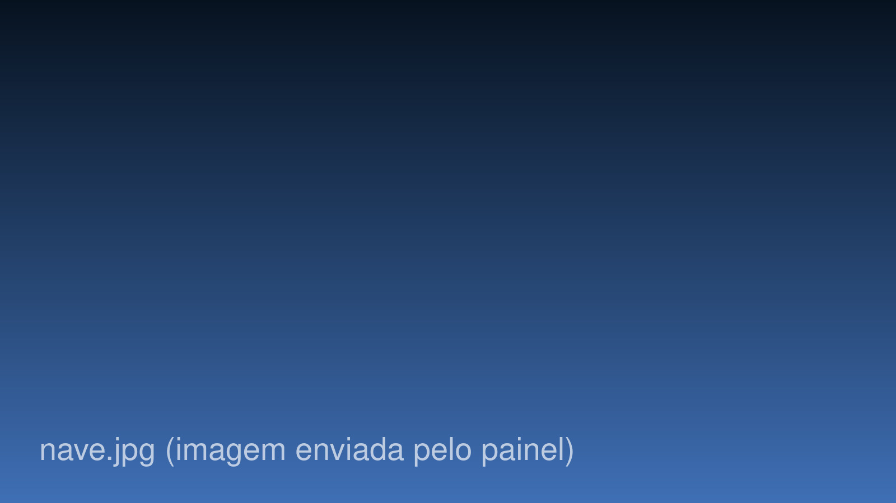

*Example review to test the layout. Delete this folder once you publish your own.*

There is a kind of game you finish and forget, and a kind you finish and carry around for a week, staring at the sky like an idiot. Outer Wilds is the second kind, and it gets there with almost nothing: a pocket solar system, a museum, a campfire and twenty-two minutes before the sun goes out.

You do not level up. You do not unlock a double jump. The only thing that grows is what you know, and that turns out to be the best progression system anyone has shipped in years.

## The loop

You wake up, roast a marshmallow, grab the ship and go. You explore a ruin, read a wall, find half of an idea. The sun explodes. You wake up at the campfire again, the other half of the idea hammering in your head.

> Nothing in the game forces you to go back. You go back because you need to know.

<Figure legenda="The ship log links every clue you found.">

</Figure>

The map is small and every corner hides a clue. The ship log keeps everything you found, linking rumors like a detective's board. It is the kind of design that trusts you, and it is rare for a game to trust you this much.

## Where it trips

Flying the ship is clumsy on purpose, and a few sections ask for a precision that does not match the rest. At some point you will swear at a black hole. It is part of the deal, but good to know going in.

<Clipe src="/videos/outer-wilds/exemplo-clipe.mp4" poster="/videos/outer-wilds/exemplo-clipe.jpg" legenda="Example clip: the landing that went wrong." descricao="The ship spinning out of control near a black hole" />

## Worth it?

Absolutely. It goes on sale all the time, runs on anything, and nothing on the market feels like it. One rule: do not look anything up. Not even the trailer. Need, no second thought.

<YouTube id="dQw4w9WgXcQ" titulo="Example video" />
